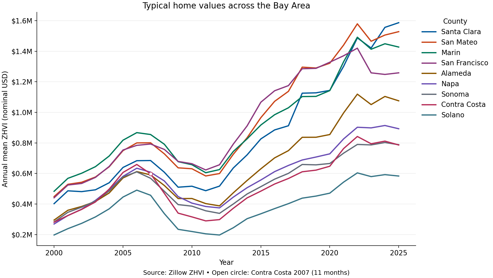
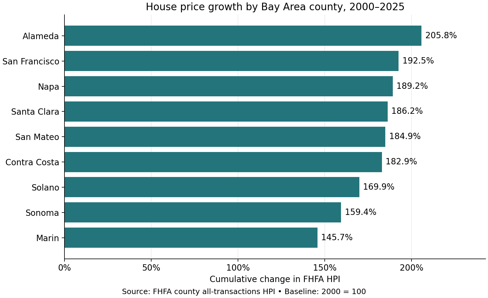

# Bay Area housing findings

- **2025 home values varied substantially across counties.** Santa Clara had the highest annual typical home value at $1.59 million, about 2.7 times Solano's $583,082, the lowest among the nine counties.
- **Typical home values fell in all nine counties between 2006 and 2011.** Solano recorded the steepest decline (-58.2%), while San Francisco recorded the smallest decline (-20.5%).
- **County trends diverged between 2022 and 2025.** Santa Clara was the only county where typical home value rose (+6.7%). San Francisco fell by 11.4%, the largest decline.
- **FHFA's index rose across all nine counties from 2000 to 2025.** Alameda recorded the largest cumulative increase (+205.8%) and Marin the smallest (+145.7%).

Dollar values use annual averages of monthly Zillow ZHVI in nominal USD. Contra Costa's 2007 average uses 11 months. FHFA changes use the annual county all-transactions index with 2000 as the baseline. Both charts describe county-level trends.

## Figures

